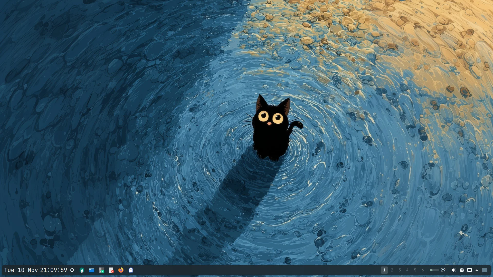
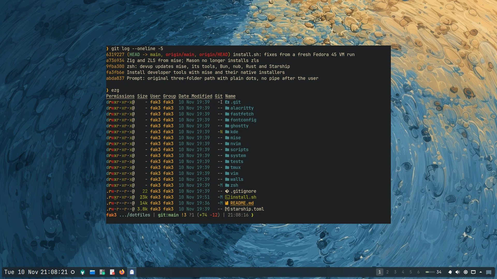

# Fedora KDE Plasma Gruvbox dotfiles

This repository recreates my Fedora KDE Plasma setup. It mixes Windows and Sway: windows float and you switch apps from the taskbar, but there are six separate workspaces driven from the keyboard. The desktop uses Breeze Charcoal colours with a steel-blue accent taken from the wallpaper, bluegrey Papirus folders and the Inter font. The terminals and editors use stock Gruvbox Dark Hard with JetBrains Mono and no ligatures.





<sub>Both taken on a fresh Fedora 45 install after running `install.sh`.</sub>

## Install on Fedora

From a fresh Fedora KDE installation:

```bash
sudo dnf install -y git
git clone https://github.com/fakelozic/dotfiles.git ~/dotfiles
cd ~/dotfiles
./install.sh            # add --system for the system tweaks below
```

Run it from inside a Plasma session so it can apply the KDE settings. From anywhere else it installs the files and tells you to run it again inside Plasma.

The first run on a fresh install only installs Fedora's pending updates, then offers to reboot. Run `./install.sh` again after the reboot to do the rest. The installation media ships the release packages, and Plasma 6.8.1, for example, draws the panel clock larger than its configured size; 6.8.2 fixes that.

The script is safe to run again. Before writing anything, it copies the existing files to:

```text
~/.local/state/dotfiles-backups/YYYYMMDD-HHMMSS-XXXXXX/
```

That includes the KDE config files it changes (`kdeglobals`, `kwinrc`, `kglobalshortcutsrc` and others). Each run gets its own backup directory.

It installs the Fedora packages the configuration uses:

- Ghostty, from the `scottames/ghostty` COPR repository;
- Alacritty, tmux, Zsh and Vim;
- `ripgrep`, `eza`, `bat`, `fd`, `fastfetch` and `wl-clipboard`;
- Papirus icons, Breeze cursors and the Inter font;
- the C compiler, `make`, `unzip` and `tree-sitter-cli` that the editor setup needs.

Then it installs the developer tools:

| Tool | Installed by | Updated with |
|---|---|---|
| Go, Node.js (with npm), pnpm, GitHub CLI (`gh`), Neovim, Zig and ZLS | [mise](https://mise.jdx.dev), from `mise/config.toml` | `mise upgrade` |
| codex | mise, from npm (`npm:@openai/codex`) | `mise upgrade` |
| Bun | its installer, `bun.sh/install` | `bun upgrade` |
| nub | its installer, `nubjs.com/install.sh` | itself |
| opencode | its installer, `opencode.ai/v2/install` | `opencode upgrade` |
| Claude Code | its installer, `claude.ai/install.sh` | itself |
| Rust | rustup, `sh.rustup.rs` | `rustup update` |
| Starship | its installer, `starship.rs/install.sh`, into `~/.local/bin` | `devup` |

mise itself comes from its installer, `mise.run`, into `~/.local/bin`.

`devup` updates them in one go: `mise self-update`, `mise upgrade` (the global tools only), `bun upgrade`, `nub upgrade`, `rustup update`, and Starship when GitHub has a newer release (its installer asks for sudo, since Starship lives in `/usr/local/bin`). It lists anything that failed at the end. Claude Code and opencode also update themselves, and T3 Code keeps its own providers current. Tools that are already installed are left alone. The installers never edit your shell files; their `PATH` entries are in `zsh/.zshrc.local`. All tools are always the latest release, so unlike the Nerd Font below they are not pinned to a checksum.

It also installs JetBrainsMono Nerd Font and Oh My Zsh, and makes Zsh your login shell. Before replacing any configuration it checks for Neovim 0.12.0 or later and `tree-sitter-cli` 0.26.1 or later.

Starship is skipped when it is already installed anywhere on `PATH`. If it is ever missing, the bundled Gruvbox Oh My Zsh theme draws the same prompt.

Installer options:

```bash
./install.sh --files-only         # only copy files: no packages, tools, login shell or KDE settings
./install.sh --skip-kde           # copy the KDE files but leave Plasma's settings alone
./install.sh --skip-update        # do not install pending Fedora updates first
./install.sh --system             # also apply system/ (asks for sudo)
./install.sh --skip-nvidia
./install.sh --skip-shell-change
./install.sh --skip-reload        # do not reload a running tmux
```

## KDE Plasma

The installer applies these settings to the running session:

- **Look:**
  - Breeze Dark Plasma style and the Breeze Charcoal colour scheme (`kde/BreezeCharcoal.colors`), with the accent saved as steel blue `#477791`;
  - Breeze cursors and window decorations with no borders;
  - a small shadow and no splash screen.
- **Folder icons:** `kde/build-folder-icons` builds `Papirus-Dark-Bluegrey`, which is Papirus-Dark with bluegrey folders, in `~/.local/share/icons`. It copies the icons rather than linking them, so Flatpak apps show them too. Run it with another Papirus colour (for example `kde/build-folder-icons teal`) to make a different variant.
- **Fonts:** Inter 10.5 for the interface (9 for the smallest text) and JetBrains Mono 11 for fixed width. `fontconfig/fonts.conf` makes the generic `monospace` font JetBrainsMonoNL, the no-ligatures build.
- **Windows:**
  - focus follows the mouse;
  - six virtual desktops in one row, switching instantly;
  - blur on, and the slide effect off.
- **Keyboard:** 250 ms repeat delay and 35 repeats per second. The Razer Viper Mini gets flat pointer acceleration.
- **Wallpaper:** `walls/cat-wall.jpeg`, on both the desktop and the lock screen.
- **Terminal:** Ghostty is the default terminal, so Dolphin's "Open Terminal" uses it.
- **GTK apps:** KDE's GTK bridge is restarted so GTK apps pick up the accent straight away.

### Shortcuts

`kde/shortcuts.py` sets these through KDE's shortcut service, so they work immediately. Run `python3 kde/shortcuts.py --check` to see whether anything differs.

| Keys | Action |
|---|---|
| `Meta+1` … `Meta+6` | Switch to desktop 1–6 (`Ctrl+F1`–`F4` keep working) |
| `Meta+Shift+1` … `Meta+Shift+6` | Move the window to desktop 1–6 |
| `Meta+Return` | New Ghostty window |
| `Meta+Shift+Q` | Close the window (`Alt+F4` too) |
| `Meta+F` | Maximize |
| `Meta+Shift+F` | Fullscreen |

Plasma's own shortcuts are unchanged. For example: `Meta+W` (Overview), `Meta+V` (clipboard), `Meta+.` (emoji), `Meta+Shift+Print` (screenshot of an area), `Ctrl+Meta+←/→` (next or previous desktop), and `Meta`+drag to move a window.

### Panel

The installer builds the panel with `kde/panel.js`, a Plasma script, the first time it runs inside Plasma. It replaces Fedora's default panel with a floating, translucent 38 px bar at the bottom holding, from left to right:

- **Digital Clock:** JetBrainsMono Nerd Font 12, seconds always, 24-hour, and the date as `ddd d MMM` beside the time;
- **Application Launcher**, with a plain circle icon;
- **Icons-only Task Manager**, with your pinned apps (only the ones that are installed);
- **Desktops** (`kde/plasmoids/org.fak3.desktops`): a minimal desktop switcher showing numbers, with the current one in a soft pill; scroll over it to switch desktops;
- **Margins Separator**;
- **RAM Indicator** (`kde/plasmoids/org.fak3.ramindicator`): a slim memory bar that turns blue, green, yellow and then red as usage rises;
- **System Tray** and **Show Desktop**.

Once a panel holds the Desktops widget, later runs leave the panel alone, so changes you make afterwards are kept. To rebuild it, remove that panel and run the installer again.

## System tweaks (`--system`)

These are in `system/` and are applied only with `--system`. Any file that differs is copied to `*.bak-<timestamp>` first.

- **zram:** `system/zram-generator.conf` makes compressed swap in RAM as large as the RAM, with zstd compression and the highest priority. A swap file is not created.
- **Swap settings:** `system/sysctl.d/99-desktop-memory.conf` sets `swappiness=180` and `page-cluster=0` (the right values for zram), adjusts the memory watermarks, and limits pending disk writes to 256 MB / 1 GB.
- **MGLRU:** `system/tmpfiles.d/mglru-min-ttl.conf` keeps the last second of each app's working memory from being swapped out. When RAM truly runs out, the kernel closes the largest app instead of freezing the desktop.
- **File index:** `/etc/updatedb.conf` gets `PRUNENAMES`, so `plocate` skips `.git`, `node_modules`, `target`, `.venv` and `__pycache__`.
- **dnf:** `/etc/dnf/dnf.conf` gets `max_parallel_downloads=10`.
- **Login screen:** Plasma Login Manager shows `walls/cat-wall.jpeg` too.

## Terminals and shell

- **Ghostty** (`ghostty/config.ghostty`):
  - Gruvbox Dark Hard, JetBrains Mono 13 with no ligatures;
  - no title bar (move windows with `Meta`+drag), no padding, no scrollbar;
  - a cursor trail drawn by `ghostty/shaders/cursor_trail.glsl`. Adjust `DURATION` and `OPACITY` at the top of that file.
- **Alacritty:** the same Gruvbox Dark Hard colours, kept as a spare terminal.
- **tmux:** the prefix is `Ctrl+Space`, with `Ctrl+A` as a second prefix; press either twice to pass it to the program in the pane. The status bar uses stock Gruvbox Dark Hard, and the session chip turns from yellow to purple while the prefix is active.
- **fastfetch:** `fastfetch/config.jsonc` shows a Fedora logo in Gruvbox blue next to three sections (system, desktop, hardware), with Nerd Font icons and Gruvbox key colours. Run `fastfetch`.
- **Zsh:** Oh My Zsh with the `git` plugin, plus a one-line Starship prompt with its parts separated by grey pipes:

  ```text
  fak3 .../lsbtw | git:main !1 ?1 (+22 -1) | 47s | exit 1 | jobs 1 | 01:40:14 ❯
  ```

  - It uses plain characters only, no Nerd Font icons, so it reads the same when pasted into a chat or an AI tool. Anything colour shows is also written as text, such as `exit 1` for a failed command.
  - The folder shows its last three levels. Inside a git repo they are counted from the repo's folder, so `~/developer/c/lsbtw` shows as `.../lsbtw`. The host appears after the user only over SSH.
  - The git counts are `!` modified, `+` staged, `?` untracked, `-` deleted, `»` renamed, `=` conflicted, `$` stashes and `↑`/`↓` commits to push or pull. `(+22 -1)` counts lines added and removed since the last commit. A detached HEAD shows as `detached <hash>`, and a rebase or merge in progress as `(REBASING 2/5)`.
  - The duration appears for commands that take 2 s or longer, the exit code only after a failure (`exit 130 INT` for Ctrl+C), and the job count only while jobs run.
  - Aliases: `ezl`, `ezo`, `ezg` and `ezt` list files with `eza`; `pstat` prints permissions; `suup` upgrades DNF and Flatpak; `devup` updates the developer tools that dnf doesn't manage (see below).

## Shell setup for the developer tools

`zsh/.zshrc.local` installs to `~/.zshrc.local`, and `.zshrc` sources it last. It holds the `PATH` entries for the tools above, a few aliases, and the line that starts mise.

- It runs `unset ARGV0` before mise. AppImages such as T3 Code export `ARGV0`, and zsh then hands that name to every program it starts, so mise would think it was a shim and fail. Apps that read your shell's `PATH` (T3 Code, editors) would then miss every mise tool.
- Every install replaces both files, after backing them up. The repository is public, so keep keys and tokens out of `.zshrc.local`.
- Projects can pin their own tool versions in their own `mise.toml`; the global ones in `~/.config/mise/config.toml` apply everywhere else.

## NVIDIA and Secure Boot

When the normal install detects NVIDIA hardware, it enables RPM Fusion, installs the NVIDIA akmod packages and builds the module.

With Secure Boot enabled, you may need to enrol the akmods certificate once before the driver can load:

```bash
sudo kmodgenca -a
sudo mokutil --import /etc/pki/akmods/certs/public_key.der
```

Choose a one-time password, reboot, select **Enroll MOK**, and enter that password. Then let the akmod build finish before rebooting again:

```bash
sudo akmods --force
modinfo -F version nvidia
```

## Editors

- **Neovim:**
  - transparent Gruvbox, one shared status line and upright comments;
  - Treesitter highlighting for JavaScript, TypeScript/TSX, Go, Rust, Zig, Lua, C and C++;
  - language servers `ts_ls`, `gopls`, `rust_analyzer`, `lua_ls` and `clangd`, installed by Mason, plus `zls` from mise so it can follow each project's Zig version.
- **Vim:** `vim/vimrc` installs to `~/.vimrc`.
  - Vim's built-in Retrobox theme, transparent gutters, relative line numbers and a small status line, with no extra plugins.
  - Yank and paste use the Wayland clipboard through `wl-clipboard`, as they do in Neovim.

The normal installer installs and checks the core editor prerequisites, with Neovim and Node.js from mise. With `--files-only`, install them yourself and check them with `./scripts/check-editor-deps`. Go, Rust, Zig and ZLS come with the developer tools. Zig and ZLS both track their latest release, and a new Zig can come out a few weeks before the matching ZLS; a project that needs a matching pair can pin both in its own `mise.toml`, for example `zig = "0.17"` and `zls = "0.17"`.

## Verification

Run the checks from the repository root:

```bash
python3 -m unittest discover -s tests -v
```

They check:

- **Editor prerequisites:** the version checks.
- **Installer:** two installs into a temporary home within the same second. Files arrive in place, Ghostty gets the shader's full path, and each run's backups survive.
- **System tweaks:** applied twice into a temporary root with `sudo` mocked. Each tweak is added only once, and the original files are kept.
- **Folder icons:** the theme is built from real files (no links), and an unknown colour is refused.
- **Shortcuts:** key codes match Qt's.

The installer and system checks need Fedora and a non-root user. Live KDE changes are not tested here, but `python3 kde/shortcuts.py --check` compares the shortcuts against a running session.
