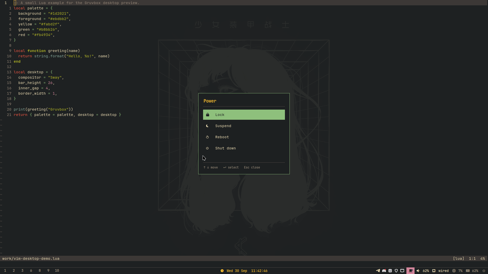

# Fedora Sway Gruvbox dotfiles

This repository recreates the current Fedora Sway setup: a restrained Gruvbox palette, a 26 px Quickshell bar on the BenQ display with its own notifications, lock screen and power menu, Alacritty, Neovim, minimal Vim, tmux, native Oh My Zsh prompt and Breeze cursors.



Desktop preview from before the move to Quickshell, using a public Lua example in Vim and the old Rofi power menu.

Firefox gets a compact dark toolbar theme of its own. It is charcoal, not Gruvbox; see [Firefox](#firefox).

## Install on Fedora

From a fresh Fedora installation:

```bash
sudo dnf install -y git
git clone https://github.com/fakelozic/dotfiles.git ~/dotfiles
cd ~/dotfiles
./install.sh
```

The script is safe to run again. Before writing configuration, it copies existing targets to:

```text
~/.local/state/dotfiles-backups/YYYYMMDD-HHMMSS-XXXXXX/
```

Each run gets a unique backup directory. Existing wallpaper files are backed up alongside the configuration.

It installs the Fedora packages used by the configuration, including `ripgrep`, `eza`, `bat`, Sway, Quickshell, Alacritty, tmux, Neovim, Vim, Breeze cursors and screenshot/clipboard utilities. It also installs JetBrainsMono Nerd Font, the Inter font and Oh My Zsh. The installer also installs the C compiler, `make`, `unzip`, `tree-sitter-cli`, Node.js and npm needed by the editor setup. It checks for Neovim 0.12.0 or later and `tree-sitter-cli` 0.26.1 or later before replacing configuration. Starship is not installed or activated because the Gruvbox Oh My Zsh theme provides the prompt directly; `starship.toml` remains in the repository as an optional configuration.

The package list also covers the NetworkManager and Bluetooth tray applets, GNOME Keyring for application secrets and the Papirus icon theme. After installing, the script sets GTK applications to dark mode with Breeze cursors and Papirus icons; the GTK theme itself is set only where Cinnamon is installed (see Cinnamon below).

The installer can be run from any desktop or from a console. Quickshell is the notification daemon, so SwayNC is disabled and masked. The clipboard services are always enabled. They are started and checked immediately only inside a running Sway session; otherwise they start at the next Sway login.

Useful installer options:

```bash
./install.sh --files-only
./install.sh --skip-nvidia
./install.sh --skip-shell-change
./install.sh --skip-reload
```

## Machine-specific shell settings

Every install replaces `~/.zshrc`. Keep `PATH` entries, toolchain managers such as mise or SDKMAN, and private aliases in `~/.zshrc.local`. The installed `.zshrc` sources that file last, and the installer never writes to it.

## NVIDIA and Secure Boot

The normal install detects NVIDIA hardware. When present, it enables RPM Fusion, installs the open-compatible Fedora NVIDIA akmod packages, builds the module and installs `sway/environment`. On other hardware, the NVIDIA environment file is skipped.

With Secure Boot enabled, the akmods certificate may need to be enrolled once before the driver can load:

```bash
sudo kmodgenca -a
sudo mokutil --import /etc/pki/akmods/certs/public_key.der
```

Choose a one-time password, reboot, select **Enroll MOK**, and enter that password. Then allow the akmod build to finish before rebooting again:

```bash
sudo akmods --force
modinfo -F version nvidia
```

## Machine-specific display layout

This setup mirrors the current two-monitor machine:

- `HDMI-A-1` is the main BenQ display and is the only display with the bar.
- `HDMI-A-2` is placed to its left.
- Workspaces 1–8 open on the BenQ; 9–10 open on the second display.

If connector names differ, inspect them with `swaymsg -t get_outputs` and update `sway/config` and `quickshell/shell.qml`.

## Key details

- Sway: 1 px subtle active border, 4 px inner and 1 px outer gaps, 20 px tab titles.
- Calculator, the Bluetooth manager and the network connection editor open floating. Firefox Picture-in-Picture floats on every workspace.
- `Super+Tab` switches windows: every open window, most recently used first, with the previous one selected. Hold Super and press Tab again to go further back; letting go switches. Type to search, `Ctrl+W` closes the selected window.
- Night light: wlsunset warms the screen to 4000 K from 18:30 to 06:30, fading over half an hour. Change the times in `sway/config` and `scripts/nightlight`.
- Bar: Quickshell, configured in `quickshell/` and started by `sway/config.d/90-bar.conf`, which replaces Fedora's Waybar launcher. Bottom, 26 px, seconds visible, square workspace indicators; RAM turns Gruvbox red above 80%. Quickshell reloads by itself when its files change; the installer restarts it.
  - Panels open above what you click and close with Escape or a click elsewhere: the clock shows a month calendar with the ISO week; volume picks the output device and sets output, microphone and per-application volume (right-click mutes, scroll changes it); network shows addresses, DNS and live download/upload; CPU and RAM show each core, memory, swap, temperature, load and the busiest processes.
  - Media: the current MPRIS track (Firefox, Telegram, Spotify…); click for cover art, a seek bar and controls, right-click to play or pause.
  - The moon toggles the night light. The cup keeps the screen awake while it is purple. Tray menus open on right-click.
  - A volume overlay appears above the bar whenever the volume changes, including from the media keys.
- Launcher: `Super+D`, or the Fedora logo at the left of the bar, searches apps and shell commands together (switch window, clipboard, keyboard shortcuts, wallpaper, Do Not Disturb, night light, stay awake, screenshots, color picker, lock, suspend, log out, reboot, shut down, reload Sway). Apps you start most come first; matching uses prefixes, word starts, initials (`vsc`) and letters in order. `→` opens an app's own actions, such as a private window. Arithmetic like `2*(3+4)` shows the answer and Enter copies it; when nothing matches, Enter runs the text as a shell command. Log out, Reboot and Shut down open the power menu to confirm.
- Keyboard shortcuts: type "shortcuts" in the launcher, or right-click the Fedora logo, for every Sway binding in plain words, read from the live config so it never goes stale. Search by key or action; Enter does it.
- Wallpaper: Quickshell draws it on every display and cross-fades when it changes; pick one with "wallpaper" in the launcher from `~/walls` or `~/Pictures/Wallpapers`. The choice, and the launcher's app counts, are kept in `~/.local/state/quickshell/dotfiles.json`. Sway's own `output * bg` stays underneath for when Quickshell is not running.
- Polkit: Quickshell asks for the administrator password when an app needs it (pkexec, Boxes, Disks…), showing the command and the polkit action. `sway/config.d/95-autostart-policykit-agent.conf` stops Fedora's lxqt agent, since only one agent can run.
- First start: a one-time notification points at `Super+D` and the shortcut list.
- Rofi: the fallback for `Super+D`, `Super+Tab` and `Super+Shift+V` when Quickshell is not running; eight rows with the original width and font.
- Power menu: the bar's power button opens Lock, Log out, Suspend, Reboot and Shut down. Arrow keys or `h`/`l` move, Enter picks, and the underlined letter picks directly.
- Lock screen: Quickshell over `walls/burning-earth.png`, checked against swaylock's PAM configuration. `Super+Escape` locks, as does swayidle after 5 minutes and before sleep (`sway/config.d/90-swayidle.conf`). When Quickshell is not running, `scripts/lock-screen` uses swaylock with the same wallpaper instead. If the lock screen ever stops responding, switch to a console with `Ctrl+Alt+F3`, log in and run `WAYLAND_DISPLAY=wayland-1 swaylock`, then switch back and unlock there.
- Notifications: drawn by Quickshell. Popups appear top-right on the BenQ for 5 s (low urgency) or 10 s, or until dismissed when critical; hovering keeps them, a click runs the default action and a middle-click dismisses. The bell counts them; `Super+N` or a click on it opens the notification center with Do Not Disturb and Clear. Right-click the bell for Do Not Disturb.
- Clipboard: `Super+Shift+V` opens the history with the selected entry shown in full on the right, images as pictures. Enter copies it again, `Shift+Del` forgets it, `Ctrl+Shift+Del` twice clears everything. Persistent user services collect new copies.
- Screenshots: `Super+Shift+S` selects an area and copies it to the clipboard. Cancelling selection or failing to capture leaves the clipboard untouched.
- tmux prefix: `Ctrl+Space`, with `Ctrl+A` as a second prefix; press either twice to pass it to the program in the pane. The session chip changes from yellow to purple while the prefix is active.
- Special Sway mode: `Super+Z`, then `c` copies a picked color, `s` copies a selected screenshot, `Shift+s` saves a selected area, and `a` saves an output screenshot. Saved screenshots go to `~/Pictures/Screenshots`.
- Cinnamon: when Cinnamon is installed, the installer loads `cinnamon/keybindings.dconf`, which gives it the Sway keys where Cinnamon has an equivalent: `Super+Return` Alacritty, `Super+D` rofi, `Super+Shift+Q` close, `Super+1`–`0` and `Super+Shift+1`–`0` for ten workspaces, `Super+H/J/K/L` or arrows snap windows, `Super+F` fullscreen, `Super+R` resize, `Super+Tab` switch windows, `Super+Shift+S` area screenshot to the clipboard, `Super+Escape` lock, `Super+Shift+E` log out, and Super+drag moves windows. Show desktop moves to `Ctrl+Super+D`. The window list's own `Super+1`–`9` and `Super+Shift+1`–`9` app shortcuts are turned off and the sound applet's `Super+Shift+S` is cleared, since they took those keys from the workspace and screenshot bindings. `Super+N` opens Cinnamon's notifications. Key repeat matches Sway: 200 ms delay, 40 per second. A RAM applet (`cinnamon/applets/ram@dotfiles`) sits left of the network icon: memory use in percent, red from 81% as on the Sway bar, memory and swap in the tooltip, and a click opens System Monitor. Clipboard history: the GPaste Reloaded applet (GPL-3, copied from linuxmint/cinnamon-spices-applets at 8057b77, without its translations) sits right of RAM and needs the `gpaste` package; `Super+Shift+V` opens it, moved from its default `Super+H`. Cinnamon has to be started after `gpaste` is installed, so the installer leaves the applet out until then. Look: `cinnamon/themes/Matcha-dark-gruvbox` is Matcha-dark-pueril (GPL-3, from vinceliuice/Matcha-gtk-theme) recoloured to Gruvbox hard dark — `#1d2021` background and `#ebdbb2` text, with Gruvbox aqua in place of Matcha's green. The panel is a shade darker, `#17191a`, to match Alacritty's background. Shapes and spacing are Matcha's. The installer copies it to `~/.themes` and `cinnamon/appearance.dconf` selects it for applications, window borders and the panel, with Inter as the interface font. To rebuild it, for example with another accent, put Matcha-dark-pueril in `~/.themes` and run `cinnamon/make-matcha-gruvbox.py [aqua|yellow|orange|green]`. The previous Cinnamon settings are saved in the backup folder as `cinnamon.dconf`, with `gnome-interface.dconf` and `nemo-desktop.dconf` for the GTK theme and font keys outside Cinnamon.
- GNOME Terminal: when it is installed, the installer loads `gnome-terminal/profile.dconf` into its default profile: Alacritty's `#17191a` background, `#f4e3b2` text, JetBrainsMono Nerd Font Mono 12, no menu bar and no scrollbar. The previous settings are saved in the backup folder as `gnome-terminal.dconf`.
- Shell aliases: `ezl`, `ezo`, `ezg` and `ezt` list files with `eza`, `pstat` prints permissions, and `suup` upgrades DNF and Flatpak. `ls` and `cat` stay stock.

The original `sve`, `tux`, `chaos`, and `orbit` wallpapers were removed. `wall.png`, `wall-gruvbox.png`, `wallg.png`, and `burning-earth.png` remain. `wall.png` is recoloured to gruvbox-charcoal: `#17191a` background and `#f2e8cf` text; `wall-gruvbox.png` is the original, `#282828` with `#ebdbb2`.

## Editors

- Neovim: transparent Gruvbox, one shared status line, upright comments, Treesitter highlighting for JavaScript, TypeScript/TSX, Go, Rust, Zig, Lua, C and C++. Language servers include `ts_ls`, `gopls`, `rust_analyzer`, `zls`, `lua_ls` and `clangd`; Mason installs the servers.
- Vim: `vim/vimrc` installs to `~/.vimrc`. Uses Vim's built-in Retrobox theme, transparent gutters, relative line numbers and a small status line, with no additional plugins. Yank and paste share the Wayland clipboard through `wl-clipboard`, as they do in Neovim.

The normal installer supplies and checks the core editor prerequisites. With `--files-only`, install those prerequisites separately and verify them with `./scripts/check-editor-deps`. Install the Go, Rust and Zig toolchains for the languages you use. Keep Zig and ZLS release versions aligned; this setup was checked with both at 0.16.0.

## Firefox

`firefox/userChrome.css` restyles Firefox's own toolbars: a charcoal palette, 3–6 px corners, a 28 px tab strip and address bar, and 14 px icons. Websites are not affected. It was written against Firefox 157 and depends on that version's toolbar design, so a later Firefox release may need the file updated.

The installer copies it into the profile Firefox opens by default, together with a one-line `user.js` that tells Firefox to load it. The profile is read from the `[Install…]` entry of `profiles.ini` under `~/.mozilla/firefox` or `~/.config/mozilla/firefox`. Existing copies of both files are backed up first; `user.js` is replaced, not merged. Firefox creates its profile on first start, so on a machine where it has never run the theme is skipped; start Firefox once and run the installer again. Restart Firefox to see changes.

The theme forces dark toolbars. For the new tab and settings pages to match, enable Firefox's built-in Dark theme once under **Add-ons and themes**.

## Verification

Run the regression checks from the repository root:

```bash
python3 -m unittest discover -s tests -v
```

The checks cover screenshot cancellation/capture errors and save locations, editor prerequisite versions, wallpaper/backup preservation across two installs with the same timestamp, the Firefox theme reaching the default profile with backups (and being skipped when there is no profile), session service setup inside and outside Sway, and, when Node.js is installed, the launcher's search ranking and calculator and the shortcut list's reading of `sway/config`. Screenshot commands are mocked so the tests do not touch your clipboard. The installer checks use a temporary home directory and run only on Fedora as a non-root user. `sudo`, `systemctl`, `gsettings` and downloads are mocked there, so real package installation, service startup and NVIDIA setup are not exercised.
